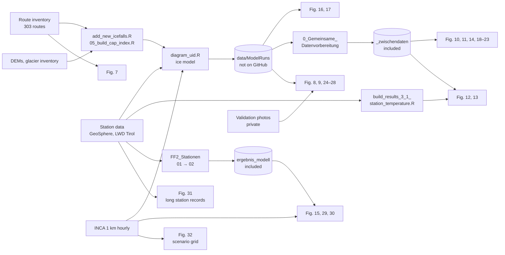

# Waterfall Ice in Tyrol – Thesis Repository

**A Meteorologically Driven Model of Waterfall Ice Growth in Tyrol: Thickness, Seasonality and Climate Sensitivity**\
Master's thesis · Carlos Wydra · University of Graz, Department of Geography and Regional Science · 2026\
Supervisor and Reviewer: Univ.-Prof. Dr.rer.nat. Wolfgang Schöner\
**Thesis version:** tag [`thesis-submission`](https://github.com/CarlosAYW/waterfall-ice-thesis/tree/thesis-submission) (this repository and the model submodule)

This repository holds the code, the intermediate data and the figure scripts behind the thesis. Of the 26 figures made by the author (Fig. 7–32):

- **14** regenerate from a clone in about a minute (tested, README 4.2),
- **2** (Fig. 12, 13; R) have all inputs included but were not re-run for this README,
- **1** (Fig. 7) additionally downloads basemaps,
- **9** need the per-route model runs (≈ 8 GB, regenerable) and/or private validation photographs.

> **Relation to `ice-waterfalls`.** The thesis cites [github.com/CarlosAYW/ice-waterfalls](https://github.com/CarlosAYW/ice-waterfalls) (model and operational map). That repository is included here as a **git submodule at `Ice fall modeling/GutHub/ice-waterfalls`, pinned to its tag `thesis-submission`**, i.e. the exact model version used in the thesis. Its `main` branch and the [interactive map](https://carlosayw.github.io/ice-waterfalls/) keep running daily and may differ from the thesis version.

## Reviewer quick guide

| I want to … | Go to |
|---|---|
| find script, inputs and output behind a figure | [2 Figure index](#2-figure-index) |
| find the file behind a number in the text | [2.3 Key numbers](#23-key-numbers--files) |
| read the model code cited in Appendix 7.1 | [3 Thesis section → code](#3-thesis-section--code) |
| regenerate figures myself | [4 Reproduce](#4-reproduce) |
| know from which folder to start a script | [5 Path rules](#5-path-rules) |
| see data sources and what is not public | [6 Data lineage and availability](#6-data-lineage-and-availability) |

---

## 1 Repository layout

```
waterfall-ice-thesis/                          ← repository root (the author's local folder "Masterarbeit")
├── README.md · requirements.txt · CITATION.cff
│
├── Ice fall modeling/GutHub/ice-waterfalls/   MODEL — git submodule, tag thesis-submission
│   ├── scripts/        diagram_uid.R (ice model), add_new_icefalls.R, 00_build_inversion_cache.R, map build
│   ├── analysis/       cold_air_pooling/ (CAP index), icefall_structure/, study_area_map/,
│   │                   Icefall_validation/Review_Tool/ (review tool + decision export, no photographs)
│   ├── data/           route inventory, station assignment, CAP tables, 1 km DEM, glacier inventory,
│   │                   INCA netCDF of the study winter, topographic sun windows
│   └── .github/workflows/build_site.yml   daily operational run → GitHub Pages
│
├── Diagramm_Skripte/                          FIGURE SCRIPTS (one folder per thesis section)
│   ├── pfade.py                               defines every path relative to its own location
│   ├── 0_Gemeinsame_Datenvorbereitung/        model runs → intermediate data (shared preprocessing)
│   ├── 2_1_Untersuchungsgebiet/               § 2.1   study area
│   ├── 2_Methoden/                            § 2.2.8 validation method figures
│   ├── 3_1_Meteorologische_Bedingungen/       § 3.1
│   ├── 3_2_Modellierte_Eisentwicklung/        § 3.2
│   ├── 3_3_und_3_4_Raeumliche_Unterschiede_und_Steuerung/   § 3.3, 3.4
│   ├── 3_5_Cold-Air-Pooling-Korrektur/        – (no longer in the thesis; kept for the record)
│   ├── 3_6_Validierung/                       § 3.5      ┐ folder numbers follow an
│   ├── 3_7_und_3_8_Dekadische_Entwicklung_und_Szenarien/  § 3.6, 3.7 ┘ earlier chapter numbering
│   │   └── abbildungen/                       (in every section folder) figure files as used in the thesis
│   ├── _zwischendaten/                        frozen intermediate data read by the figure scripts
│   └── README.md                              German working log (figure numbers there are outdated)
│
├── FF2_Stationen/                             DECADAL RUNS 2012/13–2025/26 (§ 2.3, § 3.6)
│   ├── 01_stationscheck.R                     station availability and coverage
│   ├── 02_ff2_modelllauf.R                    model runs with homogeneous station temperature, trends
│   ├── ergebnis/                              coverage tables
│   └── ergebnis_modell/                       run logs, kennzahlen.txt (key numbers), tabellen/
│
└── output/                                    legacy output folder: only the 8 CSV files scripts read,
                                               OSM tiles (zoom 10) and the images of Fig. 8/9
```

German terms: *Diagramm_Skripte* figure scripts · *Zwischendaten* intermediate data · *Abbildungen* figures · *Ergebnis* results · *Kennzahlen* key numbers · *Tabellen* tables · *Stationen* stations · *Validierung* validation.

## 2 Figure index

**From clone?** — **yes** = regenerated in the test of README 4.2 · *yes, untested* = all inputs included, not re-run · *download* = fetches basemaps, needs extra packages · **no** = needs the model runs (README 4.3) and/or private validation photographs (README 6).\
Script paths are relative to `Diagramm_Skripte/`; outputs lie in `abbildungen/` next to the script unless stated otherwise. Upstream scripts (←) are listed in [2.2](#22-upstream-scripts).

| Fig. | § | Script | Output file | Main inputs ← producer | From clone? |
|---|---|---|---|---|---|
| 1–6 | 1 | – | – | literature figures, see captions | – |
| 7 | 2.1 | [`2_1_…/build_study_area_map.py`](Diagramm_Skripte/2_1_Untersuchungsgebiet/build_study_area_map.py) | `study_area_icefall_inventory_map.png` | route inventory (model repo); OSM, Natural Earth (download) | *download* |
| 8, 9 | 2.2.8 | [`2_Methoden/build_method_figs.py`](Diagramm_Skripte/2_Methoden/build_method_figs.py) | thesis version: `output/results_3_3_to_3_6/fig_method_workflow.png`, `fig_method_case.png` | model runs; review cases | **no** – model runs, photos |
| 10, 11, 14 | 3.1 | [`3_1_…/build_31figs.py`](Diagramm_Skripte/3_1_Meteorologische_Bedingungen/build_31figs.py) | `fig_3_1_station_temperature_distribution.png`, `…_freezing_share.png`, `…_degree_hours_by_elevation.png` | `_zwischendaten/uid_daily_drivers.csv`, `uid_static.csv` ← preprocessing | **yes** |
| 12, 13 | 3.1 | [`3_1_…/build_fig12_13_303.R`](Diagramm_Skripte/3_1_Meteorologische_Bedingungen/build_fig12_13_303.R) | `fig_3_1_station_humidity_wind_radiation.png`, `…_topographic_sun_hours.png` | `output/results_3_1_meteorological_conditions/station_temperature_daily_route_summary.csv` ← `build_results_3_1_station_temperature.R`; `_zwischendaten/uid_daily_drivers.csv` | *yes, untested* |
| 15 | 3.1 | [`3_1_…/build_31_station_reference.py`](Diagramm_Skripte/3_1_Meteorologische_Bedingungen/build_31_station_reference.py) | `fig_3_1_station_winter_reference.png` | `FF2_Stationen/ergebnis_modell/tageswerte_voll.rds` ← `02_ff2_modelllauf.R`; `output/results_3_1_meteorological_conditions/inca_winter_reference/*.csv` ← `build_inca_winter_reference.R` | **yes** |
| 16, 17 | 3.2 | [`3_2_…/build_results_3_2_modelled_ice.py`](Diagramm_Skripte/3_2_Modellierte_Eisentwicklung/build_results_3_2_modelled_ice.py) | `fig_3_2_modelled_ice_thickness.png`, `fig_3_2_growth_melt_cold_phases.png` | model runs (303 routes, ending 2026-04-30) | **no** – model runs |
| 18 | 3.2 | [`3_2_…/build_allfalls.py`](Diagramm_Skripte/3_2_Modellierte_Eisentwicklung/build_allfalls.py) | `fig_3_2_all_routes.png` | `_zwischendaten/` ← preprocessing; `uid_season_metrics.csv` ← `build_3_34.py` | **yes** |
| 19, 20, 22, 23 | 3.3, 3.4 | [`3_3_und_3_4_…/build_3_34.py`](Diagramm_Skripte/3_3_und_3_4_Raeumliche_Unterschiede_und_Steuerung/build_3_34.py) | `fig_3_3_elevation.png`, `fig_3_3_aspect_sun_cap.png`, `fig_3_4_thermal_window.png`, `fig_3_4_seasonal_controls.png` | `_zwischendaten/`; `cap_kontra_routen.csv` ← `cap_kontrafaktisch.py`; `faktoren_kontra_routen.csv` ← `faktoren_kontrafaktisch.py` | **yes** |
| 21 | 3.3 | [`3_3_und_3_4_…/build_map_only.py`](Diagramm_Skripte/3_3_und_3_4_Raeumliche_Unterschiede_und_Steuerung/build_map_only.py) | `fig_3_3_map_ice_days.png` | `uid_season_metrics.csv` ← `build_3_34.py`; OSM tiles (included) | **yes** |
| 24 | 3.5 | [`3_6_Validierung/build_val5.py`](Diagramm_Skripte/3_6_Validierung/build_val5.py) | `fig_3_5_validation_overview_v5.png` | model runs; review decisions | **no** – model runs, photos |
| 25, 26 | 3.5 | [`3_6_Validierung/build_series_multi.py`](Diagramm_Skripte/3_6_Validierung/build_series_multi.py) | `fig_photo_series_uid93.png`, `…_uid224.png` | model runs; photographs | **no** – model runs, photos |
| 27 | 3.5 | [`3_6_Validierung/build_appendix_102_v2.py`](Diagramm_Skripte/3_6_Validierung/build_appendix_102_v2.py) | `fig_A1_taschach_v2.png` | model run of route 102; photographs | **no** – model runs, photos |
| 28 | 3.5 | [`3_6_Validierung/build_sunfig.py`](Diagramm_Skripte/3_6_Validierung/build_sunfig.py) | `fig_3_5_sun_effect.png` | `_zwischendaten/uid_daily_drivers.csv`; photograph | **no** – photograph |
| 29, 30 | 3.6 | [`3_7_und_3_8_…/build_fig_3_7_stationen.py`](Diagramm_Skripte/3_7_und_3_8_Dekadische_Entwicklung_und_Szenarien/build_fig_3_7_stationen.py) | `fig_3_7_homogeneity.png`, `fig_3_7_decadal_stations.png` | `FF2_Stationen/ergebnis_modell/tabellen/` ← `02_ff2_modelllauf.R` | **yes** |
| 31 | 3.6 | [`3_7_und_3_8_…/build_longrec_fig.py`](Diagramm_Skripte/3_7_und_3_8_Dekadische_Entwicklung_und_Szenarien/build_longrec_fig.py) | `fig_3_6_longrec.png` | `_zwischendaten/longrec_winters.csv` ← `get_longrec_winters.R` | **yes** |
| 32 | 3.7 | [`3_7_und_3_8_…/build_fig2628.py`](Diagramm_Skripte/3_7_und_3_8_Dekadische_Entwicklung_und_Szenarien/build_fig2628.py) | `fig_3_7_scenarios.png` | `_zwischendaten/grid_res_all.pkl` ← `run_grid.py`; `traj_*.json` ← `szenario_trajektorien.py` (see README 8) | **yes** |

### 2.2 Upstream scripts

These scripts produced the inputs that are shipped with the repository. Re-running them is optional and needs network access or the model runs.

| Script | Produces | Needs |
|---|---|---|
| [`0_Gemeinsame_Datenvorbereitung/`](Diagramm_Skripte/0_Gemeinsame_Datenvorbereitung) `prep_uid_v2.py` → `recompute_chunk.py` → `thick_chunk.py` → `prep_caches.py` | `_zwischendaten/uid_*.csv`, `uid_*.pkl` | model runs |
| [`3_3_und_3_4_…/cap_kontrafaktisch.py`](Diagramm_Skripte/3_3_und_3_4_Raeumliche_Unterschiede_und_Steuerung/cap_kontrafaktisch.py), [`faktoren_kontrafaktisch.py`](Diagramm_Skripte/3_3_und_3_4_Raeumliche_Unterschiede_und_Steuerung/faktoren_kontrafaktisch.py) | counterfactual runs without CAP / single factors (Fig. 20c, 23b) | model runs |
| [`3_1_…/build_results_3_1_station_temperature.R`](Diagramm_Skripte/3_1_Meteorologische_Bedingungen/build_results_3_1_station_temperature.R) | station-based route summary (Fig. 12, 13) | GeoSphere and LWD Tirol APIs; INCA netCDF of the model repo |
| [`3_1_…/build_inca_winter_reference.R`](Diagramm_Skripte/3_1_Meteorologische_Bedingungen/build_inca_winter_reference.R) | INCA reference winters (Fig. 15) and INCA cache for `run_grid.py` | GeoSphere INCA API |
| [`3_7_und_3_8_…/run_grid.py`](Diagramm_Skripte/3_7_und_3_8_Dekadische_Entwicklung_und_Szenarien/run_grid.py) → [`szenario_trajektorien.py`](Diagramm_Skripte/3_7_und_3_8_Dekadische_Entwicklung_und_Szenarien/szenario_trajektorien.py) | warming-response grid and scenario trajectories (Fig. 32) | INCA cache |
| [`3_7_und_3_8_…/get_longrec_winters.R`](Diagramm_Skripte/3_7_und_3_8_Dekadische_Entwicklung_und_Szenarien/get_longrec_winters.R) | long station records (Fig. 31) | GeoSphere API |
| [`FF2_Stationen/01_stationscheck.R`](FF2_Stationen/01_stationscheck.R) → [`02_ff2_modelllauf.R`](FF2_Stationen/02_ff2_modelllauf.R) | decadal runs, homogeneity and trend tables (Fig. 15, 29, 30) | station APIs; 01: 10–20 min, 02: many hours |

### 2.3 Key numbers → files

| Thesis | Source |
|---|---|
| Tables 2–3 (model parameters) | `coef <- list(` block in [`scripts/diagram_uid.R`](https://github.com/CarlosAYW/ice-waterfalls/blob/thesis-submission/scripts/diagram_uid.R) |
| § 3.1 comparison with reference winters | [`Diagramm_Skripte/3_1_…/abbildungen/station_reference_comparison.csv`](Diagramm_Skripte/3_1_Meteorologische_Bedingungen/abbildungen/station_reference_comparison.csv) |
| § 3.2 season summary | [`Diagramm_Skripte/_zwischendaten/modelled_ice_summary.json`](Diagramm_Skripte/_zwischendaten/modelled_ice_summary.json) |
| § 3.3–3.4 statistics | [`Diagramm_Skripte/_zwischendaten/stats_3_3_3_4.json`](Diagramm_Skripte/_zwischendaten/stats_3_3_3_4.json) |
| § 3.3–3.4 counterfactual effects (CAP, single factors) | [`…/abbildungen/cap_kontrafaktisch_kennzahlen.txt`](Diagramm_Skripte/3_3_und_3_4_Raeumliche_Unterschiede_und_Steuerung/abbildungen/cap_kontrafaktisch_kennzahlen.txt), [`…/faktoren_kontrafaktisch_kennzahlen.txt`](Diagramm_Skripte/3_3_und_3_4_Raeumliche_Unterschiede_und_Steuerung/abbildungen/faktoren_kontrafaktisch_kennzahlen.txt) |
| § 3.5 validation summary | [`Diagramm_Skripte/_zwischendaten/validation_v5_summary.json`](Diagramm_Skripte/_zwischendaten/validation_v5_summary.json), [`validation_class_comparison_v5.csv`](Diagramm_Skripte/_zwischendaten/validation_class_comparison_v5.csv) |
| § 3.6 decadal trends | [`FF2_Stationen/ergebnis_modell/kennzahlen.txt`](FF2_Stationen/ergebnis_modell/kennzahlen.txt), [`tabellen/band_trends.csv`](FF2_Stationen/ergebnis_modell/tabellen/band_trends.csv), [`tabellen/route_trends.csv`](FF2_Stationen/ergebnis_modell/tabellen/route_trends.csv) |
| § 3.7 scenario trajectories | [`Diagramm_Skripte/_zwischendaten/traj_general.json`](Diagramm_Skripte/_zwischendaten/traj_general.json), [`traj_sites.json`](Diagramm_Skripte/_zwischendaten/traj_sites.json) |

## 3 Thesis section → code

Model code links point to the tagged thesis version of `ice-waterfalls`.

| § | Content | Code |
|---|---|---|
| 2.1 | study area, route inventory | [`data/Koordinaten_Wasserfaelle/`](https://github.com/CarlosAYW/ice-waterfalls/tree/thesis-submission/data/Koordinaten_Wasserfaelle); the 303 route IDs used: `Diagramm_Skripte/_zwischendaten/uid_static.csv` |
| 2.2.2 | input preparation: station assignment, DEM inputs, sun windows, wind shelter | [`scripts/add_new_icefalls.R`](https://github.com/CarlosAYW/ice-waterfalls/blob/thesis-submission/scripts/add_new_icefalls.R) |
| 2.2.2 | cold-air-pooling index | [`analysis/cold_air_pooling/05_build_cap_index.R`](https://github.com/CarlosAYW/ice-waterfalls/blob/thesis-submission/analysis/cold_air_pooling/05_build_cap_index.R) |
| 2.2.4–2.2.7 | forcing, topographic modifiers, ice thickness, output | [`scripts/diagram_uid.R`](https://github.com/CarlosAYW/ice-waterfalls/blob/thesis-submission/scripts/diagram_uid.R) |
| 2.2.5 | three-station inversion monitoring | [`scripts/00_build_inversion_cache.R`](https://github.com/CarlosAYW/ice-waterfalls/blob/thesis-submission/scripts/00_build_inversion_cache.R) |
| 2.2.8 | photo review: review interface, case building, decision export | [`analysis/Icefall_validation/Review_Tool/`](https://github.com/CarlosAYW/ice-waterfalls/tree/thesis-submission/analysis/Icefall_validation/Review_Tool) (photographs not included, README 6) |
| 2.3 | decadal runs and trend analysis | [`FF2_Stationen/01_stationscheck.R`](FF2_Stationen/01_stationscheck.R), [`FF2_Stationen/02_ff2_modelllauf.R`](FF2_Stationen/02_ff2_modelllauf.R) |
| 3.1–3.7 | results | [2 Figure index](#2-figure-index) |

## 4 Reproduce

### 4.1 Clone (≈ 1.2 GB: ≈ 0.1 GB here, 1.1 GB model repository, mostly INCA netCDF)

```bash
git clone --recurse-submodules --shallow-submodules --branch thesis-submission \
    https://github.com/CarlosAYW/waterfall-ice-thesis.git
cd waterfall-ice-thesis
python -m pip install -r requirements.txt        # macOS/Linux: python3
python -m pip install pyproj pyshp rasterio      # only for Fig. 7
```

R packages (for the R scripts):

```r
install.packages(c("readr", "dplyr", "tidyr", "tibble", "stringr", "lubridate", "zoo", "jsonlite",
                   "ggplot2", "scales", "terra", "raster", "sf", "ncdf4", "httr", "httr2",
                   "geosphere", "png", "htmltools", "htmlwidgets", "leaflet"))
```

Cloned without submodules? Run `git submodule update --init --depth 1`. Do **not** use GitHub's *Download ZIP*: the archive does not contain the submodule.

### 4.2 Regenerate 14 figures (about one minute)

Bash (macOS/Linux, Git Bash):

```bash
for s in 3_1_Meteorologische_Bedingungen/build_31figs.py \
         3_1_Meteorologische_Bedingungen/build_31_station_reference.py \
         3_3_und_3_4_Raeumliche_Unterschiede_und_Steuerung/build_3_34.py \
         3_2_Modellierte_Eisentwicklung/build_allfalls.py \
         3_3_und_3_4_Raeumliche_Unterschiede_und_Steuerung/build_map_only.py \
         3_7_und_3_8_Dekadische_Entwicklung_und_Szenarien/build_fig_3_7_stationen.py \
         3_7_und_3_8_Dekadische_Entwicklung_und_Szenarien/build_longrec_fig.py \
         3_7_und_3_8_Dekadische_Entwicklung_und_Szenarien/build_fig2628.py
do python "Diagramm_Skripte/$s" || echo "FAILED: $s"; done
```

PowerShell (Windows):

```powershell
$scripts = "3_1_Meteorologische_Bedingungen/build_31figs.py",
           "3_1_Meteorologische_Bedingungen/build_31_station_reference.py",
           "3_3_und_3_4_Raeumliche_Unterschiede_und_Steuerung/build_3_34.py",
           "3_2_Modellierte_Eisentwicklung/build_allfalls.py",
           "3_3_und_3_4_Raeumliche_Unterschiede_und_Steuerung/build_map_only.py",
           "3_7_und_3_8_Dekadische_Entwicklung_und_Szenarien/build_fig_3_7_stationen.py",
           "3_7_und_3_8_Dekadische_Entwicklung_und_Szenarien/build_longrec_fig.py",
           "3_7_und_3_8_Dekadische_Entwicklung_und_Szenarien/build_fig2628.py"
foreach ($s in $scripts) { python "Diagramm_Skripte/$s" }
```

Fig. 12 and 13 (R; inputs included, not re-run for this README): `Rscript Diagramm_Skripte/3_1_Meteorologische_Bedingungen/build_fig12_13_303.R`

**Expected result.** The scripts overwrite the committed PNGs in the `abbildungen/` folders. In a test on 7 October 2026 on a local clone of this repository (model submodule at the tagged commit; no model runs, no private data; Python 3.10.12; started from an unrelated directory) all 14 figures matched the images embedded in the thesis with a mean pixel deviation of at most 0.24 of 255 grey levels (anti-aliasing; the files are not byte-identical). `git status` lists the rewritten files; `git checkout -- Diagramm_Skripte` restores the originals.

### 4.3 Regenerate the model runs (several hours, not re-run for this README)

The model writes one file per route to `Ice fall modeling/GutHub/ice-waterfalls/data/ModelRuns/model_uid<ID>.csv`, taking the route ID as argument and the end date from `MODEL_END_DATE`. The thesis runs cover 1 Oct 2025 – 30 Apr 2026 for the 303 IDs in `Diagramm_Skripte/_zwischendaten/uid_static.csv`. The batch script originally used for them is not preserved; the loop below calls the model in the same way but was not re-run for this README. The model downloads INCA point series and station data from the GeoSphere Austria and Lawinenwarndienst Tirol APIs (cached in `data/inca_nordtirol/point_timeseries/` and similar folders, which are not version-controlled), so results match the thesis only as long as the provider data are unchanged.

<details>
<summary>Commands</summary>

```bash
cd "Ice fall modeling/GutHub/ice-waterfalls"
export MODEL_END_DATE=2026-04-30
Rscript scripts/diagram_uid.R 93                                   # one route as a test
for id in $(python -c "import pandas as p; print(*p.read_csv('../../../Diagramm_Skripte/_zwischendaten/uid_static.csv').uid)"); do
  Rscript scripts/diagram_uid.R "$id"
done
cd ../../..
for s in prep_uid_v2 recompute_chunk thick_chunk prep_caches; do
  python "Diagramm_Skripte/0_Gemeinsame_Datenvorbereitung/$s.py"
done
python Diagramm_Skripte/3_2_Modellierte_Eisentwicklung/build_results_3_2_modelled_ice.py    # Fig. 16, 17
python Diagramm_Skripte/3_3_und_3_4_Raeumliche_Unterschiede_und_Steuerung/faktoren_kontrafaktisch.py
python Diagramm_Skripte/3_3_und_3_4_Raeumliche_Unterschiede_und_Steuerung/cap_kontrafaktisch.py  # then runs build_3_34.py
```

PowerShell: replace the first loop by

```powershell
$env:MODEL_END_DATE = "2026-04-30"
Import-Csv ../../../Diagramm_Skripte/_zwischendaten/uid_static.csv | ForEach-Object { Rscript scripts/diagram_uid.R $_.uid }
```
</details>

> **Caution:** the preprocessing and the counterfactual scripts overwrite the version-controlled files in `Diagramm_Skripte/_zwischendaten/` and the figures in `abbildungen/`. Restore the thesis state with `git checkout -- Diagramm_Skripte`.

### 4.4 Decadal runs (FF2)

`Rscript FF2_Stationen/01_stationscheck.R` (base R, 10–20 min, about 700 downloads; resumable). Then open `FF2_Stationen/02_ff2_modelllauf.R`, set `MODUS <- "probe"` (4 routes × 2 winters, 5–15 min) or `"voll"` (all routes and winters, many hours; resumable) and run it with `Rscript FF2_Stationen/02_ff2_modelllauf.R` or RStudio *Source* (line by line only with `FF2_Stationen/` as working directory). It works on a copy of the model in `%LOCALAPPDATA%\FF2_modell` (Windows) or `FF2_Stationen/FF2_modell` and writes to `FF2_Stationen/ergebnis_modell/`. The optional comparison with the 2025/26 runs reads `output/opus48/figs_new/modelled_ice_uid_daily.csv`, which is not included (10 MB, regenerable): `build_results_3_2_modelled_ice.py` writes it to `Diagramm_Skripte/_zwischendaten/`, from where it has to be copied; without it the comparison is skipped.

> **Caution:** the scripts write into version-controlled folders. `01_stationscheck.R` overwrites `ergebnis/`; a `"voll"` run of `02_ff2_modelllauf.R` overwrites the tables, key numbers and figures in `ergebnis_modell/` that Fig. 15, 29 and 30 read. A `"probe"` run only writes files marked `_probe`. Restore the thesis state with `git checkout -- FF2_Stationen`.

## 5 Path rules

**Do not rename or move any folder below the repository root**, including `Ice fall modeling/`, `GutHub` (a typo kept on purpose) and the German folder names. All scripts locate their files through these exact names and relative positions. The name of the root folder itself does not matter (`waterfall-ice-thesis` after cloning, `Masterarbeit` on the author's machine).

| Scripts | Start from | Why |
|---|---|---|
| `Diagramm_Skripte/**/*.py` | any directory | `pfade.py` derives all paths from its own location: root = parent of `Diagramm_Skripte/`, model repository = `<root>/Ice fall modeling/GutHub/ice-waterfalls`, intermediate data = `Diagramm_Skripte/_zwischendaten/` |
| `Diagramm_Skripte/**/*.R` | any directory via `Rscript <path>` or RStudio *Source*; for line-by-line execution first `setwd()` to the repository root | the script header finds its own path and calls `setwd()` to the repository root (its error message calls this folder "Masterarbeit", the author's local name for it) |
| `FF2_Stationen/*.R` | any directory | paths are built from the script's own folder |
| model repository: `scripts/*.R`, `analysis/**/*.R` | `Ice fall modeling/GutHub/ice-waterfalls/` | paths such as `data/AWS/…` are relative to that folder (as in the GitHub Actions workflow) |

Paths contain spaces: always quote them, e.g. `cd "Ice fall modeling/GutHub/ice-waterfalls"`.

## 6 Data lineage and availability



| Data | Source | Used in | In this repository |
|---|---|---|---|
| gridded meteorology, hourly, 1 km | GeoSphere Austria, INCA (`inca-v1-1h-1km`) | model forcing; reference winters (§ 3.1); scenario grid (§ 3.7) | study-winter netCDF in the model repo (read by `build_results_3_1_station_temperature.R`); the model itself and all other winters fetch INCA via the API |
| station data | GeoSphere Austria (`klima-v2-10min`, `klima-v2-1d`); Lawinenwarndienst Tirol (open data, wiski.tirol.gv.at) | temperature forcing, inversion monitoring, decadal runs, long records | derived tables only; raw series are downloaded by the scripts |
| elevation | Land Tirol DGM 5 m, Austria-wide DGM 5 m, Ötztal DOM 50 cm, EU-DEM, 1 km DEM on the INCA grid | topographic modifiers, CAP index | 1 km DEM only; the high-resolution DEM/DOM rasters (several GB) are too large for Git and available from the providers |
| glaciers | Austrian glacier inventory GI 4 (2015) | CAP index | yes, model repo `data/Glacier/` |
| route inventory | compiled by the author | all | yes, model repo `data/Koordinaten_Wasserfaelle/` |
| model runs | this work | § 3.2–3.5 | **no** (≈ 8 GB, beyond GitHub limits): regenerate as in README 4.3 or request the archived runs from the author (contact in README 9) |
| validation photographs and condition reports | posted by ice climbers in a private chat group and on a website, winter 2025/26 | § 2.2.8, § 3.5 | **no**: third-party photographs, privacy. Review tool and the exported decisions (without photographs and free-text reports) are included (README 3). Examiners can request access to the material from the author (contact in README 9). |
| basemaps | © OpenStreetMap contributors; Natural Earth | Fig. 7, 21 | OSM tiles zoom 10 |
| large intermediate files | this work (e.g. `uid_daily_new.csv`, `prep_uid_v2_daily_drivers.csv`, `modelled_ice_uid_daily.csv`) | pipeline steps of README 4.3 | **no**: no shipped figure script reads them and the pipeline regenerates them; the same applies to the SVG/PDF versions of Fig. 7 (the PNG is included) |

## 7 Software environment

- **Python** 3.10 — tested with 3.10.12, numpy 2.2.6, pandas 2.3.3, matplotlib 3.10.9, scipy 1.15.3, Pillow 12.3, pyreadr 0.5.7 (`requirements.txt`); newer versions are likely to work but were not tested. Fig. 7 additionally needs pyproj, pyshp and rasterio.
- **R** 4.5.3 (the author's version; packages in README 4.1). `01_stationscheck.R` needs base R only. No R script was executed for this README; the package list was compiled from the scripts' `library()` and `pkg::` calls.

## 8 Known limitations

- Folder numbers in `Diagramm_Skripte/` follow an earlier chapter numbering; the mapping is in README 1. File names can carry old numbers too (e.g. `build_fig2628.py` makes Fig. 32, `fig_3_7_homogeneity.png` belongs to § 3.6); the figure index is authoritative.
- `3_7_und_3_8_…/szenario_trajektorien.py` reconstructs a lost original script from the method description; against the trajectory files used in the thesis it deviates by at most 0.1 ice days.
- The batch script for the thesis model runs is not preserved; README 4.3 gives a loop that calls the model in the same way (untested).
- Regenerated PNGs are visually identical to the thesis figures but not byte-identical.
- Some script names carry version suffixes (`_v2`, `_v5`); the figure index names the version used.
- `Diagramm_Skripte/README.md` is the author's German working log; use the figure index above.

## 9 Citation and licence

Wydra, C. (2026): *A Meteorologically Driven Model of Waterfall Ice Growth in Tyrol: Thickness, Seasonality and Climate Sensitivity.* Master's thesis, University of Graz. See `CITATION.cff`.

Contact: Carlos Wydra, [carlos.wydra@edu.uni-graz.at](mailto:carlos.wydra@edu.uni-graz.at)

Copyright © 2026 Carlos Wydra. All rights reserved. Use is limited to reading, review and assessment in the context of the master's thesis.
